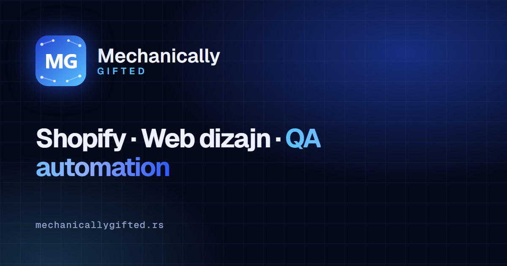

# mechanicallygifted.rs

Source of [mechanicallygifted.rs](https://mechanicallygifted.rs), the site for my work: Shopify development, simple websites for small businesses and QA test automation.



## What is in it

- **Two real language pages**: `/` (Serbian) and `/en/` (English), each with its own title, description, canonical and `hreflang` links, so Google indexes both. The SR/EN switch is a plain link, no JavaScript.
- **Structured data**: `ProfessionalService` + `FAQPage` JSON-LD in the page language.
- **Open Graph / Twitter cards** with a 1200 × 630 share image, `favicon.svg`, `apple-touch-icon.png`, `sitemap.xml` with hreflang alternates, `robots.txt`.
- **Animated network hero** on a `<canvas>`: fewer points on phones, pauses when off screen or in a background tab, respects `prefers-reduced-motion`.
- **About card**: closed by default (content `inert`), opens in place with the photo, story and tools.
- **Google reviews**: up to 5 review cards in their original language that slide by themselves (paused on touch, hover, keyboard focus and with `prefers-reduced-motion`). A Netlify Function (`netlify/functions/reviews.mjs`) reads them from the Places API with a 24 h CDN cache once an API key is set in the Netlify environment; until then the cards come from reviews copied in the generator. No review schema markup (Google guideline).
- **Fast**: Geist is inlined as base64 so the first text paints in the right font, the hero canvas starts after load. PageSpeed mobile 100 on both languages.
- **No framework, no build step for the visitor**: one HTML file per language, inline CSS and JS.
- Tested with Selenium in [qa-automation](https://github.com/MilosG997/qa-automation).

## How it is generated

| File | Role |
|---|---|
| `dizajn.html` | The design: markup plus the SR/EN text dictionary |
| `stil.css` | All styles (Geist + Geist Mono) |
| `napravi-sajt.py` | Builds `sajt/index.html` and `sajt/en/index.html` from the design: puts the right language text into the HTML, adds SEO tags, JSON-LD, contact and portfolio links |
| `napravi-slike.py` | Renders the share image, icons and project screenshots with headless Chrome |
| `portfolio.py` | Portfolio folders (Shopify, Websites & apps, Web design, QA): SR/EN texts, alt texts, 16:10 WebP thumbnails + gallery images (up to 1800 px) |
| `recenzije.js` | Review cards and the auto-slider, loaded when the section comes near the screen |
| `netlify/functions/reviews.mjs` | Serverless function for Google Places reviews (key only in Netlify env, never in git) |
| `portfolio.js` | Folders (one open at a time, keyboard, inert when closed) and the Web design lightbox, built on first open |
| `sajt/` | The finished site, deployed to Netlify |
| `mechanically-gifted-tech.html` | The original single-file design this started from |

```bash
python napravi-slike.py   # only when images change
python portfolio.py      # only when portfolio images change
python napravi-sajt.py
netlify deploy --prod --no-build --dir sajt --functions netlify/functions
```

Hosting: Netlify (Netlify DNS, automatic HTTPS).
